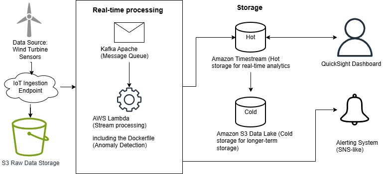

# Wind Turbine Fault Detection

A Python tool that processes raw wind turbine telemetry, identifies fault patterns across a fleet, and automatically flags faulty turbines in a report. Built during the Bright Network Internship Experience UK (Technology & Engineering), 2026.

## What it does

- Reads raw telemetry data from Excel files
- Analyses the data to identify fault patterns across the turbine fleet
- Flags faulty turbines automatically
- Outputs a report summarising the results

## Architecture

The diagram shows the end-to-end data pipeline, from data ingestion through processing to output. The reasoning behind these design decisions is explained in the [technical report](docs/engineering-report.pdf).

## Built with

- Python 
- Docker, for consistent and reproducible results on any machine
